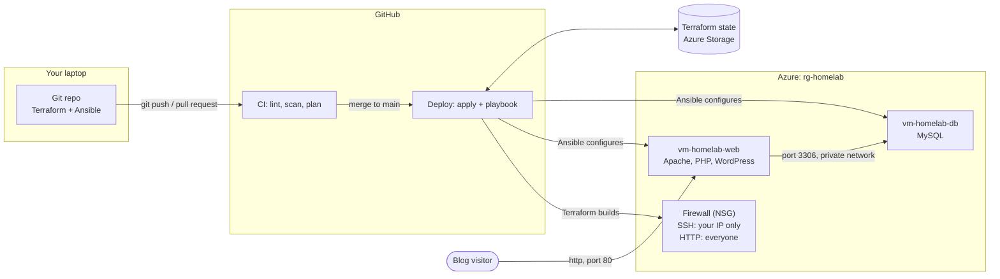
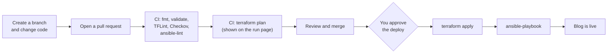

# Ingram Cloud Lab: WordPress on Azure with Terraform, Ansible, and GitHub Actions

**Live site:** this lab hosts my tech blog, where I document what I build and learn about cloud infrastructure.

## Why I built this

I'm an MIS student at Georgia College working toward a career in cloud and solutions engineering. After setting up a LAMP server by hand in a Linux course, I wanted to learn how infrastructure teams build and manage servers with code instead. I built this lab to get hands-on with the tools they use, Terraform, Ansible, Azure, and CI/CD, and to give my blog a real home. Every upgrade I make to the lab becomes a post on the blog.

A two-server lab built entirely from code:

- **Terraform** builds the infrastructure in Azure: a network, a firewall, and two Ubuntu VMs.
- **Ansible** configures them: MySQL on the database server; Apache, PHP, and WordPress on the web server.
- **GitHub Actions** runs CI/CD: every pull request is linted, security-scanned, and planned; every merge to `main` is deployed after your approval.

## How it fits together



## The CI/CD flow



## What's in the repo

```
homelab/
├── .github/workflows/
│   ├── ci.yml              # lint + security scan + plan on pull requests
│   ├── deploy.yml          # apply + Ansible on merge to main
│   └── destroy.yml         # manual teardown
├── terraform/
│   ├── versions.tf         # Terraform + provider versions, remote state backend
│   ├── providers.tf        # Azure provider
│   ├── variables.tf        # inputs (with validation)
│   ├── main.tf             # network, firewall, 2 VMs, Ansible inventory
│   ├── outputs.tf          # IPs, blog URL, SSH commands
│   ├── templates/inventory.tftpl
│   ├── terraform.tfvars.example
│   └── .tflint.hcl
├── ansible/
│   ├── ansible.cfg
│   ├── site.yml            # the playbook: which roles run on which servers
│   ├── group_vars/all.yml  # database name, user, password (from env)
│   ├── requirements.yml
│   └── roles/
│       ├── common/         # updates, basic tools, auto security patches
│       ├── mysql/          # MySQL, database, user limited to the lab subnet
│       └── web/            # Apache, PHP, WordPress, Apache site config
├── scripts/
│   ├── bootstrap-state.sh  # one-time: storage for Terraform state
│   └── setup-github-oidc.sh# one-time: passwordless GitHub -> Azure sign-in
└── README.md
```

---

## Part 0: Install your tools

1. **Azure for Students:** sign up with your school email for free credit.
2. **GitHub account:** free. (Apply for the GitHub Student Developer Pack too; it's free and includes extras.)
3. **Windows users:** Ansible doesn't run on Windows directly. In PowerShell (as admin) run `wsl --install`, restart, and do everything below in the **Ubuntu** terminal. Mac users can use Terminal.
4. **Install:** Azure CLI, Terraform, Ansible, and Git. Use each tool's official install instructions for your system.
5. **Check:**
   ```bash
   az version
   terraform -version
   ansible --version
   git --version
   ```

## Part 1: Build the lab from your laptop

Do this first. It's the best way to understand each piece before automating it.

**1. Sign in to Azure**
```bash
az login
export ARM_SUBSCRIPTION_ID=$(az account show --query id -o tsv)
```

**2. Make an SSH key just for the lab**
```bash
ssh-keygen -t rsa -b 4096 -f ~/.ssh/homelab -N ""
```
This creates `~/.ssh/homelab` (private: never share or commit it) and `~/.ssh/homelab.pub` (public).

**3. Create storage for Terraform's state (one time)**
```bash
bash scripts/bootstrap-state.sh
```
Write down the `TFSTATE_RG` and `TFSTATE_SA` values it prints; you'll need them in Part 2.

**4. Fill in your values**
```bash
cp terraform/terraform.tfvars.example terraform/terraform.tfvars
curl -s https://api.ipify.org; echo     # your home IP
cat ~/.ssh/homelab.pub                  # your public key
```
Open `terraform/terraform.tfvars` and paste them in. Add `/32` to the end of your IP.

**5. Build the infrastructure**
```bash
cd terraform
terraform init -backend-config=backend.hcl
terraform fmt
terraform validate
terraform plan          # expect "Plan: 12 to add"
terraform apply         # type yes; takes about 3-5 minutes
```
When it finishes, it prints your `blog_url`, the `db_private_ip`, and SSH commands. Try one: `ssh -i ~/.ssh/homelab labadmin@<web ip>`, then `exit`.

**What the 12 resources are:** resource group, virtual network, subnet, firewall (NSG), firewall-to-subnet link, 2 public IPs, 2 network cards, 2 VMs, and the Ansible inventory file.

**6. Configure the servers**
```bash
cd ../ansible
export WP_DB_PASSWORD='pick-a-strong-password'
ansible all -m ping        # both should answer "pong"
ansible-playbook site.yml
```
Each task prints **changed** (it did something) or **ok** (already correct).

**7. Finish WordPress in your browser**

Open the `blog_url`. On the setup page enter:
- Database name: `wordpress`
- Username: `wpuser`
- Password: your `WP_DB_PASSWORD`
- Database host: the `db_private_ip` (not localhost; the database is on the other server)

**8. See idempotency**

Run `ansible-playbook site.yml` again. Almost everything now says **ok**: Ansible only changes what's different.

**9. Tear it down when you're done**
```bash
cd ../terraform
terraform destroy
```
You can rebuild everything any time with `terraform apply` and `ansible-playbook site.yml`.

## Part 2: Automate it with GitHub Actions (CI/CD)

**1. Put the code on GitHub**

Create a new repo named `homelab` on GitHub (empty, no README). Then from the project folder:
```bash
git init
git add .
git commit -m "Initial home lab"
git branch -M main
git remote add origin https://github.com/YOUR_USERNAME/homelab.git
git push -u origin main
```
Check that `terraform.tfvars`, `backend.hcl`, and `inventory.ini` were **not** pushed (`.gitignore` keeps them out).

The first push to `main` will start the Deploy workflow, and it will fail because the secrets aren't set yet. That's expected.

**2. Let GitHub sign in to Azure without a password (OIDC)**
```bash
bash scripts/setup-github-oidc.sh YOUR_USERNAME/homelab
```
It prints three values for the next step.

**3. Add repository secrets**

GitHub repo → **Settings → Secrets and variables → Actions → New repository secret**:

| Secret | Value |
|---|---|
| `AZURE_CLIENT_ID` | from setup-github-oidc.sh |
| `AZURE_TENANT_ID` | from setup-github-oidc.sh |
| `AZURE_SUBSCRIPTION_ID` | from setup-github-oidc.sh |
| `TFSTATE_RG` | from bootstrap-state.sh |
| `TFSTATE_SA` | from bootstrap-state.sh |
| `ADMIN_CIDR` | your home IP with /32 |
| `SSH_PUBLIC_KEY` | contents of `~/.ssh/homelab.pub` |
| `SSH_PRIVATE_KEY` | contents of `~/.ssh/homelab` (the whole file) |
| `WP_DB_PASSWORD` | your WordPress database password |

**4. Add an approval gate**

**Settings → Environments → New environment** → name it `lab` → check **Required reviewers** and add yourself. Now nothing deploys until you click Approve.

Note: required reviewers on a **private** repo need GitHub Pro (free with the Student Developer Pack). On a public repo it's free. Public is fine here: no secrets are in the code.

**5. Try the full flow**
```bash
git checkout -b add-owner-tag
```
Make a small change, for example add `owner = "marilyn"` inside `tags` in `terraform/main.tf`. Then:
```bash
terraform -chdir=terraform fmt
git commit -am "Add owner tag"
git push -u origin add-owner-tag
```
On GitHub, open a **pull request**. Watch the **CI** workflow run lint, the security scan, and `terraform plan`. Open the run's summary page to read the plan. Merge the PR, go to **Actions → Deploy**, approve it, and watch Terraform and Ansible run.

**6. Destroy from GitHub**

**Actions → Destroy → Run workflow** → type `destroy`.

## How the deploy reaches the servers securely

The firewall only allows SSH from your home IP. GitHub's runners get a new IP each time, so `deploy.yml`:
1. looks up the runner's IP,
2. adds a temporary firewall rule for that IP only,
3. runs Ansible,
4. deletes the rule, even if a step failed.

That last step matters. If the rule stayed, the next `terraform plan` would show it as **drift** (a change made outside Terraform) and remove it.

## Cost

Two `Standard_B1s` VMs plus two public IPs cost roughly a few cents per hour together. The state storage account costs pennies per month. **Destroy the lab when you're not using it.** Check **Cost Management** in the Azure portal now and then.

## Troubleshooting

| Problem | Fix |
|---|---|
| `SkuNotAvailable` during apply | That VM size isn't offered in that region for your subscription. Set `location = "eastus2"` or `vm_size = "Standard_B2s"` in `terraform.tfvars`. |
| SSH or Ansible ping times out | Your home IP probably changed. Update `admin_cidr` (and the `ADMIN_CIDR` secret) and run `terraform apply`. |
| `setup-github-oidc.sh` says you lack permission | Some school accounts block app registrations. Part 1 still works fully. For Part 2, try a personal Azure account, or ask your school's IT. |
| `couldn't resolve module/action 'community.mysql...'` | Run `ansible-galaxy collection install -r ansible/requirements.yml`. |
| WordPress says "Error establishing a database connection" | Use the `db_private_ip` as the database host, and the same password you exported as `WP_DB_PASSWORD`. |
| `Error acquiring the state lock` | Another run is using the state. Wait for it to finish. Only if you're sure nothing is running: `terraform force-unlock <LOCK_ID>`. |
| Checkov shows many findings | Normal for a lab. It doesn't fail the build. Read a few and decide what you'd fix in production. |

## Ideas to extend it

- Store `WP_DB_PASSWORD` with **Ansible Vault** instead of an environment variable.
- Move the database off the public internet: remove its public IP and reach it through the web server (a "jump host").
- Add **Azure Bastion** or a VPN instead of opening SSH at all.
- Turn the VM block into a reusable **Terraform module**.
- Add HTTPS with Let's Encrypt.
- Add monitoring (Azure Monitor agent, or Prometheus + Grafana on a third VM).

